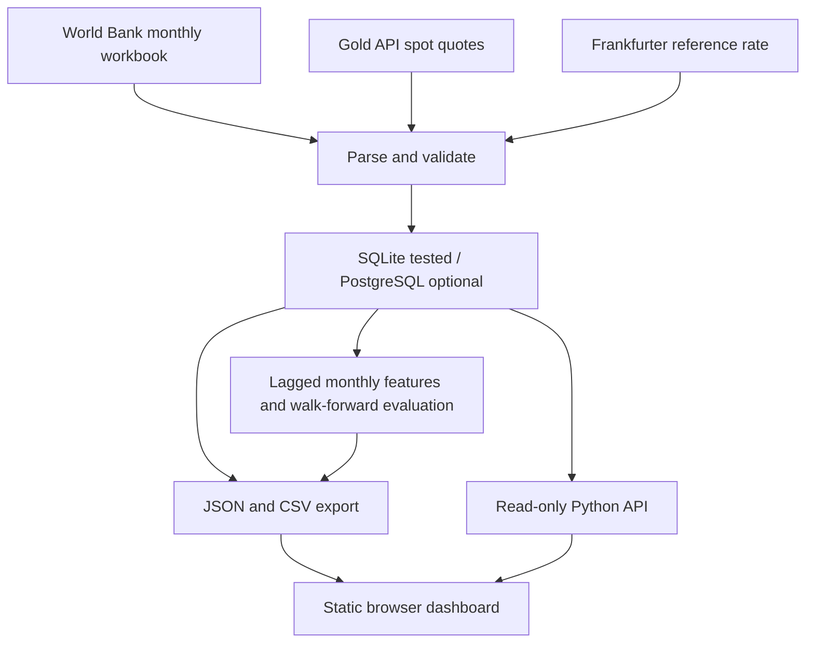

# System architecture / source-derived design

This document describes the new implementation, not the unavailable earlier project.

## Business scope

A reviewer should be able to inspect where a price came from, its unit/frequency, what was actually loaded and how a model compares to a transparent baseline. No checkout, authentication system, order execution or account balances are in scope.

## Requirements / acceptance criteria

| ID | Requirement | Acceptance evidence |
|---|---|---|
| G01 | Collect actual provider responses | live-refresh.txt with URLs, HTTP status, retrieval time and response SHA |
| G02 | Preserve units and temporal meaning | source/series/frequency/unit validation; separate quote cards and monthly chart |
| G03 | Repeat runs without duplicate keys | exact-row replay twice; runtime-verification.json |
| G04 | A source outage must be visible and preserve prior data | isolated fault-injection test reports partial/failed; never reported as a real outage |
| G05 | UI values must originate from DB export | JSON/CSV/SQL count and value checks; browser chart/table checks |
| G06 | Evaluate ML only with sufficient historical observations | min 180 training feature rows + 36 test rows; no model on insufficient/gapped input |
| G07 | No same-period target feature leakage | shifted features, future-target perturbation test; training end strictly before each test period |
| G08 | Do not promote an inferior candidate | compare MAE to naive; forecast null when candidate loses |

## Persistence and key

`observations` primary key: `(source, series, frequency, observed_at)`. Existing keys are updated with the provider's returned value and retrieval/hash provenance. Source batches are validated before transactional UPSERT; a failed source does not clear old observations. `pipeline_runs` and `source_runs` store actual ingest outcomes. `model_runs` stores model status and the full research evaluation JSON.

SQLite is the verified local runtime. PostgreSQL uses the same source schema with DOUBLE PRECISION and psycopg placeholders; its runtime is explicitly untested here.

## API and delivery

- `GET /api/health`: database row count and ingest status.
- `GET /api/snapshot`: read database tables, history and latest stored model report.
- Static mode reads `data/published/snapshot.json`; `?mode=api` requires the Python service.
- No write API is exposed. Raw responses, DB files, SQL source and `.env` are not served by the Python app. Public published CSV/JSON are intentional exports.
- GitHub Pages serves the recorded export, not a continuously running Python database backend.

## Orchestration

Core CLI stages are ingest → model → export (`refresh` runs all). Airflow has a manual DAG for these stages. GitHub has offline CI plus a manual refresh workflow, replaying previously recorded observations before adding newly fetched data. Provider credentials are never needed by the frontend.
